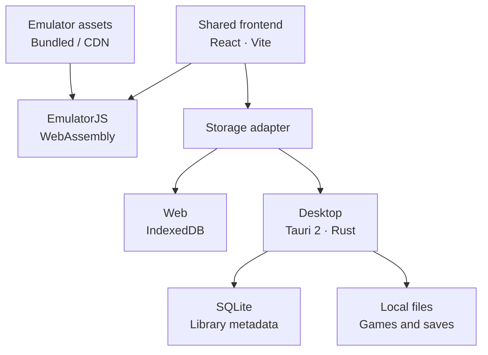

# Oasis

English | [简体中文](README.zh.md)

Osmanthus wine, and days with old friends.

Oasis (拾光 / Ky Play) is a personal game library for the browser, macOS, and Windows. It combines local game management, emulation, and saved progress without requiring an account or a separate emulator installation.

[Open website](https://play.kuangye.team/) · [Download desktop app](https://github.com/kuangye-team/ky-play/releases/latest) · [GitHub](https://github.com/kuangye-team/ky-play)

**Games, BIOS files, and saves stay in the current browser or desktop app. They are not uploaded to the website server or automatically synced between devices.**

[Features](#features) · [Architecture](#architecture) · [Installation and deployment](#installation-and-deployment) · [Configuration](#configuration) · [Copyright and licenses](#copyright-and-licenses)

## Features

| Capability | Description |
| --- | --- |
| Personal game library | Manage local games with collections, favorites, search, and play history |
| Multi-system emulation | EmulatorJS integrates multiple emulator cores with keyboard, gamepad, and touch support |
| Saved progress | Save states, in-game saves, and progress import/export |
| Web and desktop | Installable web app, macOS Universal app, and Windows x64 app |
| Local data management | No account or server database required; configurable desktop library directory |
| Languages and sample games | Simplified Chinese and English, with two bundled open-source NES games |

Game compatibility and performance depend on the emulator core, device, and browser. Users supply other games and any required BIOS files.

## Architecture

The web and desktop editions share a React, TypeScript, and Vite frontend in `ssg/`. EmulatorJS provides the WebAssembly runtime, while a storage adapter selects the platform's data backend. Tauri 2 and Rust provide native desktop capabilities. The website only needs static hosting, with no game-library backend to deploy.



### Platforms and data boundaries

| Comparison | Web | Desktop |
| --- | --- | --- |
| Runtime | Browser with WebAssembly and IndexedDB | macOS (Apple Silicon / Intel), Windows x64 |
| Storage | IndexedDB; language and theme preferences in localStorage | SQLite and local files, with a configurable directory |
| Capacity | Browser storage quotas and a 1 GB per-game limit | Available disk space, without the browser's fixed per-game limit |
| Offline use | Caches application pages; emulator binaries and games are not precached | Bundles emulator resources by default to run imported local games |
| Updates | Service worker updates to web resources | Signed application updates verified before installation |

Browser libraries belong to the site's origin. Clearing site data or changing the website address may make existing data inaccessible. Web and desktop libraries are independent; save import/export transfers progress between them. Editions configured with a CDN need network access to load emulator resources.

### Repository layout

| Path | Responsibility |
| --- | --- |
| [`ssg/`](ssg/) | Shared frontend, emulator integration, static assets, and browser storage |
| [`app/`](app/) | Tauri shell, native Rust storage, and desktop packaging |
| [`scripts/`](scripts/) | Configuration generation, resource preparation, and release tooling |
| [`docker/`](docker/) | Compose deployment using published images |
| [`.github/workflows/`](.github/workflows/) | CI, desktop releases, and container image publishing |
| [`ssg/licenses/`](ssg/licenses/) | Third-party licenses, sources, and checksums |

## Installation and deployment

Use the [website](https://play.kuangye.team/) or download a [desktop installer](https://github.com/kuangye-team/ky-play/releases/latest). For your own deployment:

| Option | Deliverable | Suitable for |
| --- | --- | --- |
| Static hosting | `ssg/dist/` | Existing static website hosting |
| Docker | Nginx image for linux/amd64 and linux/arm64 | Container-based self-hosting |
| Cloudflare Workers | Static website with CDN emulator resources | Cloudflare hosting |
| Desktop build | macOS Universal DMG, Windows x64 installer, and update files | Distributing your own desktop app |

### Prerequisites

| Environment | Requirements |
| --- | --- |
| Web source builds | Node.js ≥ 22.12.0 and npm |
| Desktop source builds | The above, Rust ≥ 1.90, and [Tauri prerequisites](https://v2.tauri.app/start/prerequisites/) |
| Container deployment | Docker and Docker Compose; BuildKit for local image builds |

Run commands from the repository root unless stated otherwise. Shell examples use macOS/Linux syntax. Build desktop installers on their corresponding operating systems.

```sh
git clone https://github.com/kuangye-team/ky-play.git
cd ky-play
npm --prefix ssg ci
npm ci
npm run init
```

Initialization creates `.env.json` from its template and generates environment configuration. Dependency installation and subsequent development/build commands prepare EmulatorJS 4.2.3 as needed, verify resources, and generate third-party notices. Initial preparation requires network access to download resources.

### Website and static hosting

| Operation | Command | Address or output |
| --- | --- | --- |
| Local development | `npm run dev` | <http://localhost:5173> |
| Production build | `npm run build` | `ssg/dist/` |
| Local preview | `npm run preview` | <http://localhost:4173> |

Serve `ssg/dist/` over HTTPS, fall back to `index.html` for single-page application routes, and preserve the headers required for emulator threading:

```text
Cross-Origin-Opener-Policy: same-origin
Cross-Origin-Embedder-Policy: require-corp
```

Serve `sw.js` with cache revalidation. Hosting examples are in [`nginx.conf`](nginx.conf) and [`ssg/public/_headers`](ssg/public/_headers).

### Docker

Published images require neither Node.js nor a local build. Start with the repository's Compose configuration:

```sh
cd docker
cp .env.example .env
docker compose up -d
```

The default address is <http://localhost:8080>. Image name, tag, and port settings are described in [`docker/.env.example`](docker/.env.example). To build from source, run `npm run compose` from the repository root.

### Cloudflare Workers

After source setup, configure `wrangler.ssg` (Worker name and domains) and `wrangler.ssg.vars` (frontend settings) in `.env.json`, then run:

```sh
(cd ssg && npx wrangler login)
npm run deploy
```

### Desktop app

Run `npm run desktop:dev` for local development. Before a release build, configure [update signing](#desktop-updates-and-signing), then build on the corresponding system:

| Platform | Build preparation | Build command |
| --- | --- | --- |
| macOS Universal | `rustup target add aarch64-apple-darwin x86_64-apple-darwin` | `npm run desktop:build` |
| Windows x64 | Visual Studio C++ Build Tools and WebView2 | `npm run desktop:build -- --target x86_64-pc-windows-msvc` |

The installed application is named **Ky Play**. Installers, update packages, signatures, and `latest.json` for the current platform are collected in `app/dist/`. After gathering both platforms' artifacts, run `npm run desktop:manifest` to generate a complete update manifest.

The repository includes [desktop release](.github/workflows/release.yml) and [container publishing](.github/workflows/docker-publish.yml) workflows for `vMAJOR.MINOR.PATCH` tags. Container images also publish `latest` on updates to `main`. See each workflow for credentials and optional signing configuration.

## Configuration

Use [`.env.json.example`](.env.json.example) as the template, edit the root `.env.json`, and run `npm run init` to generate environment files and Wrangler configuration. Generated files are overwritten and should not be maintained directly. Process environment variables take precedence over file settings, except for Cloudflare frontend deployment builds.

| Section | Purpose |
| --- | --- |
| `prepare` | Emulator resource downloads |
| `local.ssg` | Local website development |
| `production.ssg` | Regular production website builds (`build:ssg`) |
| `compose.root` / `compose.ssg` | Docker ports, npm registry, and frontend build arguments |
| `desktop` | Desktop frontend, updates, signing, and releases |
| `wrangler.ssg` | Hosting overrides and frontend build parameters under `vars` for the [Wrangler template](ssg/wrangler.jsonc.example) |

### Common settings

| Setting | Purpose and default |
| --- | --- |
| `WEB_PORT` / `SERVER_PORT` | Local development / Docker host ports; defaults: `5173` / `8080` |
| `VITE_EMULATOR_CDN_URL` | Emulator CDN release directory, such as `https://cdn.emulatorjs.org/4.2.3`, excluding `/data/` |
| `VITE_WEB_URL` | Public website; defaults to `https://play.kuangye.team/` |
| `VITE_CLIENT_DOWNLOAD_URL` / `VITE_API_LATEST` | Desktop download page / release manifest; defaults to this repository's latest GitHub Release and its `latest.json` |
| `EMULATORJS_ARCHIVE_URL` | Emulator archive URL; defaults to the official 4.2.3 release. Mirrors must provide identical contents |
| `NPM_REGISTRY` | npm registry for Docker builds; defaults to `https://registry.npmjs.org/` |

Regular web, Docker, and desktop builds bundle emulator resources when the CDN setting is empty. Cloudflare deployment defaults to the official CDN. An explicit CDN URL excludes bundled emulator resources from the output. Custom CDNs must use HTTPS and allow cross-origin access; custom release-manifest endpoints must also allow browser cross-origin requests.

**`VITE_*` values are public build parameters embedded in the frontend. They must not contain credentials, and changes require a rebuild.** Configure each environment separately. Container and Cloudflare runtime variables do not modify an existing frontend build. Keep local private configuration out of Git and CI credentials in GitHub Secrets.

### Desktop updates and signing

Configure these in the `desktop` section or the process environment:

| Setting | Purpose |
| --- | --- |
| `TAURI_UPDATER_URL` | HTTP or HTTPS update-manifest URL; defaults to `latest.json` in this repository's latest Release |
| `TAURI_UPDATER_PUBLIC_KEY` | Update-signing public key; use the complete `.pub` file contents |
| `TAURI_SIGNING_PRIVATE_KEY` / `TAURI_SIGNING_PRIVATE_KEY_PASSWORD` | Release private key contents or absolute path, and its password (empty for an unencrypted key) |
| `TAURI_RELEASE_BASE_URL` / `RELEASE_VERSION` | Optional HTTP or HTTPS download directory and version; defaults to the version's GitHub Release directory and root `package.json` version |

Generate an update-signing key pair:

```sh
npm run tauri -- signer generate -w /absolute/private/path/ky-play.key
```

Release builds require a valid update URL, public key, and private key; local development does not. Local update hosting supports HTTP, for example `TAURI_UPDATER_URL=http://host.docker.internal:10888/play/latest.json` with `TAURI_RELEASE_BASE_URL=http://host.docker.internal:10888/play`. HTTP updater support is enabled automatically for HTTP endpoints; package signatures are still verified. For self-hosted updates, publish `app/dist/` at the configured URLs and enable cache revalidation for `latest.json`.

Update signing is separate from operating-system code signing. The [desktop release workflow](.github/workflows/release.yml) supports macOS Developer ID signing and notarization, and optional Windows SignPath signing. It defaults to an ad-hoc macOS signature and unsigned Windows installers, which may face installation restrictions.

## Copyright and licenses

Original project code is licensed under [GPL-3.0](LICENSE), copyright © 2026 旷野团队. Games, emulator cores, third-party dependencies, and artwork retain their own licenses. Platform and game names belong to their respective owners.

The project includes these unmodified NES releases:

| Game | Author | Version | License | Source |
| --- | --- | --- | --- | --- |
| [Thwaite](https://github.com/pinobatch/thwaite-nes) | Damian Yerrick | v0.04 | [GPL-3.0](ssg/licenses/games/thwaite-nes.txt) | [Corresponding source](https://github.com/pinobatch/thwaite-nes/archive/refs/tags/v0.04.zip) |
| [nes-runner](https://github.com/zorchenhimer/nes-runner) | zorchenhimer | v1 | [MIT](ssg/licenses/games/nes-runner.txt) | [Corresponding source](https://github.com/zorchenhimer/nes-runner/archive/refs/tags/v1.zip) |

EmulatorJS, RetroArch, and individual emulator cores retain their own licenses, some with noncommercial restrictions. Full licenses, provenance, and checksums are maintained in [`ssg/licenses/`](ssg/licenses/); builds generate the notices distributed with the app. Redistribution must preserve required attribution and notices and meet applicable source requirements.

The project does not provide a commercial ROM catalog or BIOS downloads. Only use, submit, or distribute files for which you have the necessary rights.

Thanks to the bundled-game authors and contributors to EmulatorJS, emulator cores, React, Vite, Tauri, and other open-source projects.
