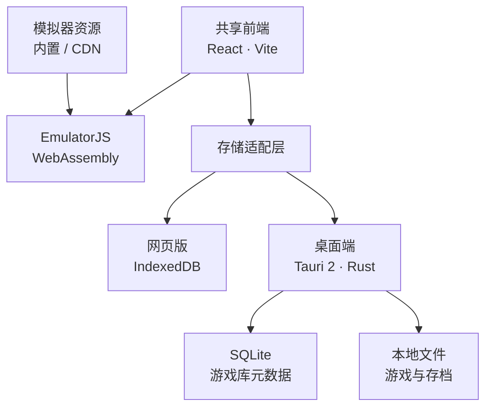

# 拾光

[English](README.md) | 简体中文

桂花载酒，与少年游。

拾光（Oasis / Ky Play）是一个支持浏览器、macOS 和 Windows 的个人游戏库，集成本地游戏管理、模拟器运行与进度保存，无需注册账号，也无需单独安装模拟器。

[在线使用](https://play.kuangye.team/) · [客户端下载](https://github.com/kuangye-team/ky-play/releases/latest) · [GitHub](https://github.com/kuangye-team/ky-play)

**游戏、BIOS 和存档保存在当前浏览器或桌面应用中，不会上传到网站服务器，也不会自动在设备之间同步。**

[能力特性](#能力特性) · [架构原理](#架构原理) · [安装部署](#安装部署) · [配置说明](#配置说明) · [版权与许可证](#版权与许可证)

## 能力特性

| 能力 | 说明 |
| --- | --- |
| 个人游戏库 | 管理本地游戏，支持分类整理、收藏、搜索与游玩记录 |
| 多平台模拟 | 基于 EmulatorJS 集成多种模拟器内核，支持键盘、手柄与触控输入 |
| 进度保存 | 支持即时存档、游戏内存档及进度导入导出 |
| 网页与客户端 | 提供可安装的网页应用、macOS 通用客户端和 Windows x64 客户端 |
| 本地数据管理 | 无需账号或服务端数据库，客户端支持自定义游戏库目录 |
| 多语言与示例游戏 | 支持简体中文和英文，附带两款开源 NES 游戏 |

游戏兼容性与运行速度取决于模拟器内核、设备和浏览器。其他游戏与所需 BIOS 由使用者自行提供。

## 架构原理

网页版和客户端共用 `ssg/` 中的 React、TypeScript 与 Vite 前端。EmulatorJS 提供 WebAssembly 模拟器运行环境，存储适配层按平台选择数据后端；桌面端由 Tauri 2 和 Rust 提供原生能力。网站服务只需托管静态资源，无需部署游戏库后端。



### 平台与数据边界

| 对比项 | 网页版 | 桌面客户端 |
| --- | --- | --- |
| 运行环境 | 支持 WebAssembly、IndexedDB 的浏览器 | macOS（Apple Silicon / Intel）、Windows x64 |
| 数据存储 | IndexedDB；语言和主题偏好使用 localStorage | SQLite 与本地文件，可自定义存储目录 |
| 容量约束 | 受浏览器存储配额限制，单个游戏上限为 1 GB | 受本地磁盘容量限制，无浏览器固定单游戏上限 |
| 离线能力 | 缓存应用页面，不预缓存模拟器程序与游戏文件 | 默认内置模拟器资源，可运行已导入的本地游戏 |
| 更新方式 | Service Worker 更新网页资源 | 校验签名后安装客户端更新 |

浏览器游戏库与网站来源绑定，清理网站数据或更换网站地址可能使原数据无法访问。网页版与客户端的游戏库相互独立，可通过存档导入导出转移进度。使用 CDN 的版本需要联网加载模拟器资源。

### 项目结构

| 路径 | 职责 |
| --- | --- |
| [`ssg/`](ssg/) | 共享前端、模拟器集成、静态资源与浏览器存储 |
| [`app/`](app/) | Tauri 桌面外壳、Rust 原生存储与应用打包 |
| [`scripts/`](scripts/) | 配置生成、资源准备与发布工具 |
| [`docker/`](docker/) | 已发布镜像的 Compose 部署配置 |
| [`.github/workflows/`](.github/workflows/) | 持续集成、客户端发布与容器镜像发布 |
| [`ssg/licenses/`](ssg/licenses/) | 第三方许可、来源与校验记录 |

## 安装部署

直接使用可访问[网页版](https://play.kuangye.team/)或下载[客户端安装包](https://github.com/kuangye-team/ky-play/releases/latest)。自行部署可选择：

| 方式 | 交付内容 | 适用场景 |
| --- | --- | --- |
| 静态托管 | `ssg/dist/` | 已有静态网站服务 |
| Docker | Nginx 镜像，支持 linux/amd64 和 linux/arm64 | 容器化自托管 |
| Cloudflare Workers | 静态网站与 CDN 模拟器资源 | Cloudflare 托管 |
| 桌面构建 | macOS 通用 DMG、Windows x64 安装包及更新文件 | 自行分发客户端 |

### 环境准备

| 环境 | 要求 |
| --- | --- |
| 网页源码构建 | Node.js ≥ 22.12.0、npm |
| 桌面源码构建 | 上述环境、Rust ≥ 1.90 和 [Tauri 系统依赖](https://v2.tauri.app/start/prerequisites/) |
| 容器部署 | Docker 与 Docker Compose；本地构建镜像需要 BuildKit |

以下命令默认在仓库根目录执行，Shell 示例采用 macOS/Linux 语法。桌面安装包需在对应操作系统上构建。

```sh
git clone https://github.com/kuangye-team/ky-play.git
cd ky-play
npm --prefix ssg ci
npm ci
npm run init
```

初始化从模板创建 `.env.json` 并生成各环境配置。依赖安装及后续开发、构建命令会按需准备 EmulatorJS 4.2.3，校验资源并生成第三方许可说明，首次准备需要联网下载资源。

### 网页与静态托管

| 操作 | 命令 | 地址或产物 |
| --- | --- | --- |
| 本地开发 | `npm run dev` | <http://localhost:5173> |
| 生产构建 | `npm run build` | `ssg/dist/` |
| 本地预览 | `npm run preview` | <http://localhost:4173> |

部署 `ssg/dist/` 时，使用 HTTPS，将单页应用路由回退到 `index.html`，并保留模拟器多线程所需的响应头：

```text
Cross-Origin-Opener-Policy: same-origin
Cross-Origin-Embedder-Policy: require-corp
```

`sw.js` 应采用缓存重新验证策略。托管配置可参考 [`nginx.conf`](nginx.conf) 和 [`ssg/public/_headers`](ssg/public/_headers)。

### Docker

使用已发布镜像时无需安装 Node.js 或在本地构建。使用仓库提供的 Compose 配置启动：

```sh
cd docker
cp .env.example .env
docker compose up -d
```

默认地址为 <http://localhost:8080>。镜像名称、标签和端口在 [`docker/.env.example`](docker/.env.example) 中说明；如需从源码构建，在仓库根目录运行 `npm run compose`。

### Cloudflare Workers

完成源码环境准备后，配置 `.env.json` 中的 `wrangler.ssg`（Worker 名称与域名）和 `production.ssg`（前端参数），再执行：

```sh
(cd ssg && npx wrangler login)
npm run deploy
```

此部署方式默认从 CDN 加载模拟器，不上传内置模拟器资源。

### 桌面客户端

本地开发运行 `npm run desktop:dev`。发布构建前须配置[更新签名](#客户端更新与签名)，然后在对应系统执行：

| 平台 | 构建准备 | 构建命令 |
| --- | --- | --- |
| macOS 通用版本 | `rustup target add aarch64-apple-darwin x86_64-apple-darwin` | `npm run desktop:build` |
| Windows x64 | Visual Studio C++ Build Tools 与 WebView2 | `npm run desktop:build -- --target x86_64-pc-windows-msvc` |

安装后的应用名称为 **Ky Play**。当前平台的安装包、更新包、签名与 `latest.json` 统一输出到 `app/dist/`。汇总两个平台的产物后，运行 `npm run desktop:manifest` 生成完整更新清单。

仓库提供[客户端发布](.github/workflows/release.yml)与[容器镜像发布](.github/workflows/docker-publish.yml)流程，使用 `vMAJOR.MINOR.PATCH` 标签发布版本。容器镜像还会在 `main` 更新时发布 `latest`；各流程的凭据与可选签名配置见对应工作流。

## 配置说明

以 [`.env.json.example`](.env.json.example) 为模板，统一修改根目录 `.env.json`，再运行 `npm run init` 生成环境文件与 Wrangler 配置。生成文件会被覆盖，不应直接维护；进程环境变量优先于文件配置。

| 配置分区 | 作用 |
| --- | --- |
| `prepare` | 模拟器资源下载 |
| `local.ssg` | 网页本地开发 |
| `production.ssg` | 网页生产构建与 Cloudflare 部署构建 |
| `compose.root` / `compose.ssg` | Docker 端口、npm 源与前端构建参数 |
| `desktop` | 桌面前端、更新、签名与发布 |
| `wrangler.ssg` | 覆盖 [Wrangler 模板](ssg/wrangler.jsonc.example)中的托管配置 |

### 常用参数

| 参数 | 用途与默认值 |
| --- | --- |
| `WEB_PORT` / `SERVER_PORT` | 本地开发 / Docker 宿主机端口，默认 `5173` / `8080` |
| `VITE_EMULATOR_CDN_URL` | 模拟器 CDN 版本目录，如 `https://cdn.emulatorjs.org/4.2.3`，不包含 `/data/` |
| `VITE_WEB_URL` | 公开网站地址，默认 `https://play.kuangye.team/` |
| `VITE_CLIENT_DOWNLOAD_URL` / `VITE_API_LATEST` | 客户端下载页 / 版本清单，默认指向本仓库最新 GitHub Release 及其 `latest.json` |
| `EMULATORJS_ARCHIVE_URL` | 模拟器压缩包地址，默认官方 4.2.3 发行包；镜像须提供相同内容 |
| `NPM_REGISTRY` | Docker 构建使用的 npm 源，默认 `https://registry.npmjs.org/` |

普通网页、Docker 和客户端构建在 CDN 参数为空时使用内置资源；Cloudflare 部署默认使用官方 CDN。显式配置 CDN 后，构建产物不再包含模拟器资源。自定义 CDN 应使用 HTTPS 并允许跨域访问；自定义版本清单地址也需允许浏览器跨域访问。

**`VITE_*` 是写入前端的公开构建参数，不应包含凭据，修改后需要重新构建。** 各环境分别配置；容器或 Cloudflare 的运行时变量不会改写已构建的前端。本地私密配置不纳入 Git，CI 凭据使用 GitHub Secrets。

### 客户端更新与签名

在 `desktop` 分区或进程环境变量中配置：

| 参数 | 用途 |
| --- | --- |
| `TAURI_UPDATER_URL` | HTTPS 更新清单地址，默认指向本仓库最新 Release 的 `latest.json` |
| `TAURI_UPDATER_PUBLIC_KEY` | 更新签名公钥，填写 `.pub` 文件完整内容 |
| `TAURI_SIGNING_PRIVATE_KEY` / `TAURI_SIGNING_PRIVATE_KEY_PASSWORD` | 发布所需的私钥内容或绝对路径，以及私钥密码（无密码时留空） |
| `TAURI_RELEASE_BASE_URL` / `RELEASE_VERSION` | 可选的下载目录与版本，默认使用对应版本的 GitHub Release 目录和根目录 `package.json` 版本 |

生成更新签名密钥：

```sh
npm run tauri -- signer generate -w /absolute/private/path/ky-play.key
```

发布构建需要有效的更新地址、公钥与私钥；本地开发不需要。自行托管更新时，将 `app/dist/` 的产物发布到配置的地址，并为 `latest.json` 启用缓存重新验证。

更新签名与操作系统代码签名相互独立。[客户端发布工作流](.github/workflows/release.yml)支持 macOS Developer ID 签名、公证及可选的 Windows SignPath 签名；默认使用 macOS 临时签名和未签名的 Windows 安装包，安装可能受到系统限制。

## 版权与许可证

项目原创代码采用 [GPL-3.0](LICENSE)，copyright © 2026 旷野团队。游戏、模拟器内核、第三方依赖与美术素材保留各自的许可证；平台及游戏名称归各自权利人所有。

项目附带以下未经修改的 NES 发行版：

| 游戏 | 作者 | 版本 | 许可证 | 源码 |
| --- | --- | --- | --- | --- |
| [小镇反弹道导弹 · Thwaite](https://github.com/pinobatch/thwaite-nes) | Damian Yerrick | v0.04 | [GPL-3.0](ssg/licenses/games/thwaite-nes.txt) | [对应源码](https://github.com/pinobatch/thwaite-nes/archive/refs/tags/v0.04.zip) |
| [无限奔跑 · nes-runner](https://github.com/zorchenhimer/nes-runner) | zorchenhimer | v1 | [MIT](ssg/licenses/games/nes-runner.txt) | [对应源码](https://github.com/zorchenhimer/nes-runner/archive/refs/tags/v1.zip) |

EmulatorJS、RetroArch 和各模拟器内核采用各自的许可，部分包含非商业限制。完整许可、来源与校验记录见 [`ssg/licenses/`](ssg/licenses/)，构建时会生成随应用分发的许可说明。再分发时须保留必要署名与声明，并履行适用许可证的源码要求。

项目不提供商业游戏 ROM 目录或 BIOS 下载。请仅使用、提交或分发具有相应权利的文件。

感谢附赠游戏作者，以及 EmulatorJS、各模拟器内核、React、Vite、Tauri 等开源项目的贡献者。
